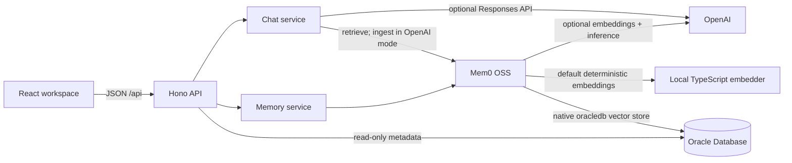
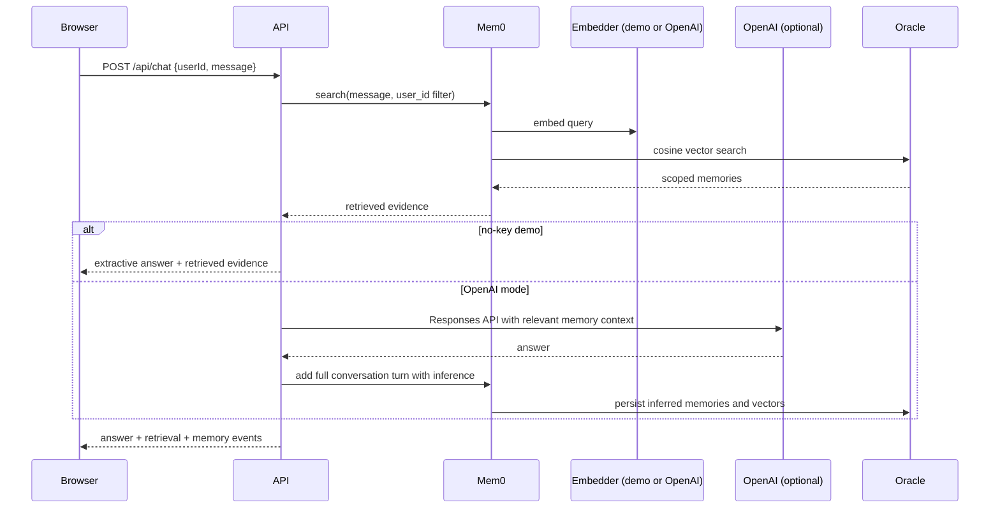

# Architecture

The browser never receives database or model credentials. It calls a narrow API whose application services enforce user scope before reaching Mem0.

## Chat sequence

## Boundaries

- `packages/shared` is the wire-contract authority.
- `packages/core` contains provider-neutral services plus the Mem0/OpenAI adapters.
- `packages/db` owns direct Oracle diagnostics and destructive-operation guards.
- `services/api` translates HTTP input into service calls and hides internal errors.
- `apps/web` consumes only the public API contract.

Mem0 history is disabled because this sample uses Oracle as its demonstrated persistence layer. The required `better-sqlite3` package remains installed because Mem0 3.3.1 imports it statically even when history is disabled.
