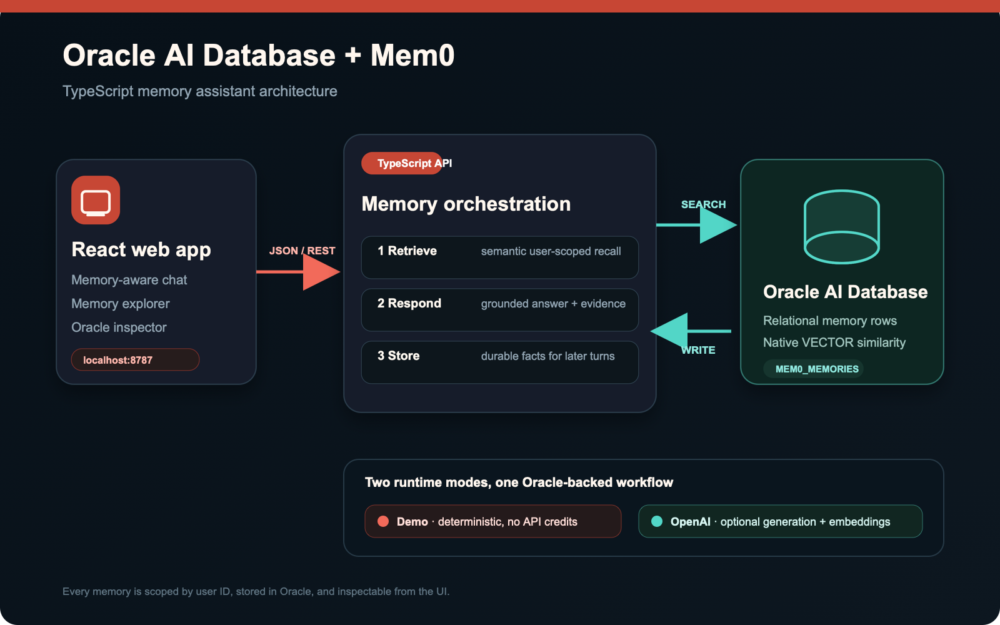
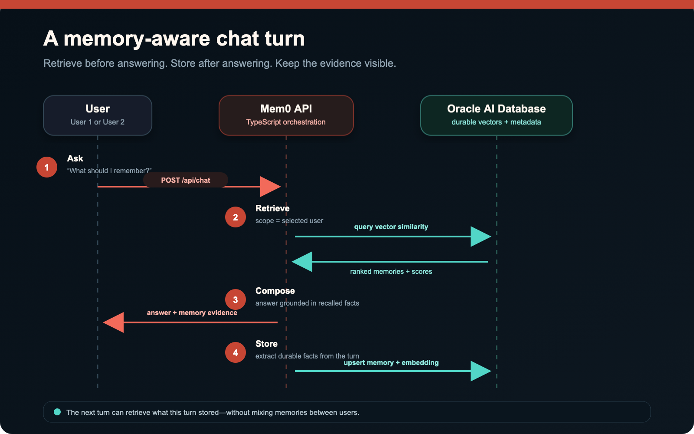
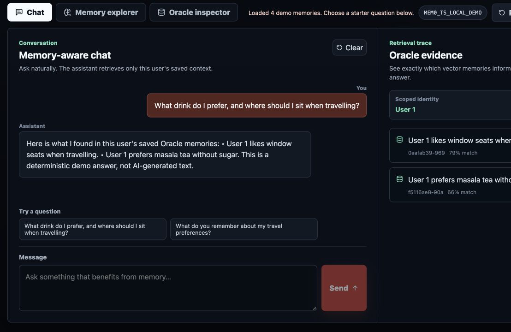
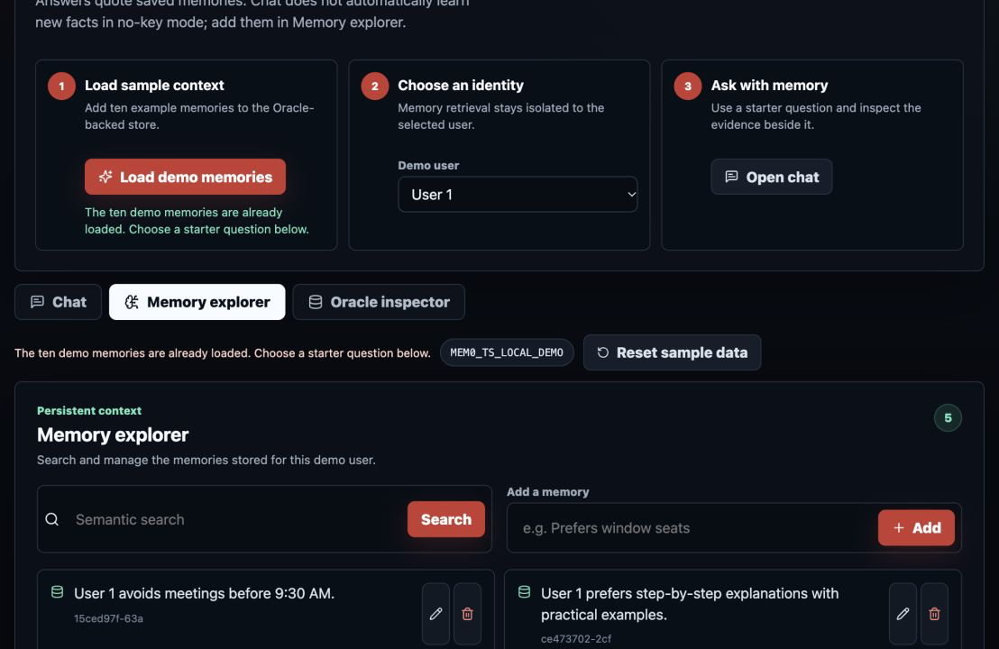
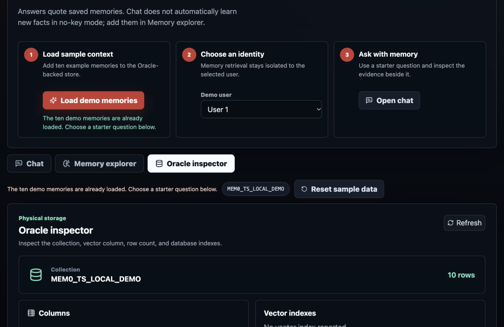

# Building a long-term memory assistant with Mem0, TypeScript, and Oracle

Retrieval-augmented generation and conversational memory solve related but different problems. RAG normally searches a document collection assembled by the application owner. Long-term memory captures durable, user-specific facts discovered during interaction: a preferred drink, a dietary restriction, or a reporting style. This sample makes that distinction visible instead of hiding it behind one chat box.

## Why Mem0 and Oracle fit together

Mem0 supplies embedding, scoped retrieval, mutation, and normalization; optional OpenAI mode also enables fact extraction. Its TypeScript OSS package includes an `oracledb` vector-store provider. Oracle supplies durable relational storage with a native `VECTOR` column and JSON payload, letting the application retain vectors and inspectable metadata in one system.

The default mode supplies a deterministic 24-dimensional TypeScript embedder through Mem0's LangChain-compatible adapter and presents extractive answers. No model API is called. Optional OpenAI mode uses OpenAI embeddings, answer generation, and Mem0 inference in a separate 1536-dimensional collection. Both modes use Oracle as the vector store. SQLite history is disabled so the demonstrated persistence boundary remains Oracle.

## One turn, three observable phases

When `user-1` sends a message, the server first searches with `filters: { user_id: "user-1" }`. The returned records are shown in the Oracle evidence pane. In no-key mode, the answer lists those saved facts and does not automatically add memories. In OpenAI mode, the records are passed to the answer adapter as untrusted evidence—not instructions; after an answer exists, the server sends the complete user/assistant turn to Mem0 with inference enabled.

The order matters. Retrieval failure, generation failure, and ingestion failure receive different internal phases. The public API returns a sanitized provider error, and an ingestion failure never claims that a memory was saved.

## Automatic and explicit memory

OpenAI-mode chat uses automatic capture (`infer: true`), which lets Mem0 extract useful facts from the turn. Demo-mode chat does not. The Memory explorer uses explicit capture (`infer: false`) in both modes, appropriate when a user deliberately creates a record. All paths require a user id. Listing and search inject that same scope, while update and delete first prove the target belongs to the caller's scope.

## A visible lifecycle

The interface has three workspaces:

1. Chat pairs the transcript with the exact memories retrieved for the latest answer.
2. Memory explorer exposes vector search and explicit create, edit, and delete operations.
3. Oracle inspector shows the physical collection, vector column, count, and vector index metadata without exposing credentials.

This makes the sample useful for learning: a developer can correlate an application action with a memory event and the resulting Oracle state.

### Memory-aware chat

The chat workspace places the deterministic answer beside the exact Oracle memories and similarity scores that informed it.

### Memory explorer

The explorer makes scoped vector search and explicit memory creation, editing, and deletion visible instead of hiding them behind chat.

### Oracle inspector

The inspector connects the application experience to its physical Oracle collection, including the relational identifier, native `VECTOR` column, JSON payload, and index metadata.

## From local demo to production

The local defaults intentionally avoid automatic vector-index creation and use two fixed demo users. A production service should add real authentication, derive user scope from trusted identity rather than request JSON, use migrations for collection/index management, apply rate limiting and audit logging, and define retention/export policies. It should also deploy Oracle and the API on a private network and load credentials from a secret manager.

The sample's reset route is intentionally narrow: callers cannot name a table, and the database layer accepts only a configured `MEM0_*_DEMO` collection and its known entity companion. That defense is useful even in a tutorial—safe defaults are part of the architecture, not cleanup work for later.
